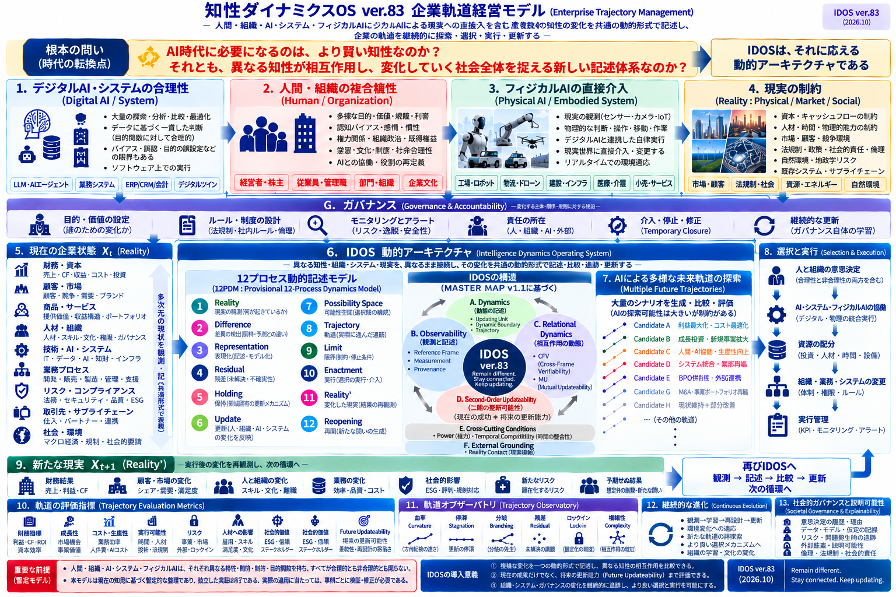

# IDOS ver.83 — 企業軌道経営モデル

**Enterprise Trajectory Management — Conceptual Model**

## 1. 根本の問い

> AI時代に必要になるのは、より賢い知性なのか。それとも、異なる知性が相互作用し、変化していく社会全体を捉える新しい記述体系なのか。

本モデルは後者の可能性を、企業経営を題材に検討するための概念的な動的アーキテクチャである。AIが探索・比較・最適化を高速に行うようになっても、企業活動は単一の合理性だけでは決まらない。人間や組織の価値判断、権力関係、慣性、制度、資金や時間の制約、さらに物理世界に介入するAIなどが相互に作用する。

そこで、個々の要素を一時点で評価するだけでなく、**異なるものを異なるまま接続し、その変化と相互作用を時間軸に沿って記述する**ことを目指す。ここでいう「OS」は完成した業務ソフトウェアを意味せず、観測・記述・比較・更新を組み立てるためのアーキテクチャという位置づけである。

## 2. 対象となる四つの領域（図の1〜4）

### 1. デジタルAI・システムの合理性

LLM、AIエージェント、ERP/CRM、業務システム等による大量の探索、分析、比較、最適化を扱う。データに基づく一貫した判断を得やすい一方、目的や評価尺度を誰が設定したか、何が観測されていないかは別途検討を要する。図は、ソフトウェア上の実行能力と、現実に対する妥当性を同一視していない。

### 2. 人間・組織の複合性

経営者・株主、従業員・管理職、部門・組織、企業文化を含む。価値観、感情、慣性、認知バイアス、権力関係、既得権益、役割の再定義などが意思決定に影響する。これらを単なる「非合理性」として除外せず、AIとは異なる性質を持つ主体の変化として観測対象に含める。

### 3. フィジカルAIの直接介入

工場・ロボット、物流・ドローン、建設・インフラ、医療・介護、小売・サービスなどを想定する。デジタルな判断が物理的な動作に接続すると、環境の変化が新たな観測を生み、次の判断にも影響する。物理的制約、安全性、現場での予期しない変化を考慮する必要がある。

### 4. 現実の制約

資本・キャッシュフロー、人材・時間・物理的能力、市場・顧客・競争環境、法規制・政策・社会的責任、自然環境・地域や地政学的リスク、既存システムやサプライチェーンなどを含む。これらは単なる初期条件ではなく、経営判断や外部環境によって変わり得る制約として扱う。

## 3. 企業の状態から次の状態へ（図の5・7〜9）

**5. 現在の企業状態 Xₜ** は、財務・資本、顧客・市場、商品・サービス、人材・組織、技術・AI・システム、業務プロセス、リスク・コンプライアンス、取引先・サプライチェーン、社会・環境などの多次元の状態を指す。図では、これらを観測・記録し、共通形式で表現することを構想している。Xₜは企業のすべてを完全に表現した数値ベクトルであると確定しているわけではない。

**7. 複数の未来軌道の探索** では、大量の候補を生成・比較・評価する。図に示すCandidate A〜Hは、利益最大化・コスト最適化、成長投資、新規事業、人間とAIの協働、システム統合、BPO、M&A、現状維持など、互いに異なる方向の例示である。単一の「最適解」を前提にせず、選択の余地と分岐を見えるようにすることに意味がある。これらの候補は予測結果や推奨順位ではない。

**8. 選択と実行** は、人と組織の意思決定、AI・システム・フィジカルAIとの協働、資源配分、組織・業務・システムの変更、実行管理からなる。合理性と非合理性の両方を含む現実の意思決定を想定する。

**9. 新たな現実 Xₜ₊₁** では、実行後の財務結果、顧客・市場、人と組織、業務、社会的影響、新たなリスク、予期せぬ結果などを再観測する。計画と異なる結果も次の記述・比較・更新の起点になる。重要なのは「実行したら終了」ではなく、**再び現実に接触する循環**である。

## 4. IDOSの12プロセス動的記述モデル（図の6）

図中の12PDM（Provisional 12-Process Dynamics Model）は、現実と記述の関係を継続的に見直すための暫定的なプロセス群である。以下は図の短いラベルを文章化したもので、厳密な測定アルゴリズムの確定を意味しない。

| 番号 | プロセス | 図における役割 |
|---|---|---|
| 1 | **Reality** | 現実の観測。何が起きているかを捉える入口 |
| 2 | **Difference** | 差異の検出。期待・予測と観測の違いを記録 |
| 3 | **Representation** | 表現。観測を記録・モデル化する |
| 4 | **Residual** | 残差。未解決・不確実なものを明示する |
| 5 | **Holding** | 保持。判断を急がず、問題や解釈を保留する更新メカニズム |
| 6 | **Update** | 更新。人・組織・AI・システムの変化を反映する |
| 7 | **Possibility Space** | 可能性空間。選択肢や行動の候補を捉える |
| 8 | **Trajectory** | 軌道。変化を時間軸に沿って追跡する |
| 9 | **Limit** | 限界。明示された制約・停止条件を扱う |
| 10 | **Enactment** | 実行。選択した行為を現実に介入させる |
| 11 | **Reality’** | 変化した現実。結果を再観測する |
| 12 | **Reopening** | 再開。閉じた問いや判断を再び開く |

**DifferenceとResidualは同義ではない。** 差異が観測されたことだけを理由に、自動的に「未解決の残差」と判定しない。残差として扱うための判断基準と根拠が必要になる。

**Holdingは単なる停滞ではない。** 早期に一つの説明へ収束させず、異なる解釈や未解決事項を保持する可能性を表す。ただし、いつでも保持すべきという規範ではなく、領域固有の期限・安全性・責任との関係で判断する。

**UpdateとReopeningも異なる。** 更新は状態・モデル・ルール等の変更を含むが、Reopeningは、いったん採用・停止・終結した判断や問いを、再観測を踏まえて開き直すことに重点がある。図の並びは観測のための整理であり、あらゆる現象が必ずこの順序を一度ずつ通ることを主張しない。

## 5. IDOSの四つの構造（図の6、MASTER MAP v1.1に基づく）

### A. Dynamics（動態の記述）

Updating Unit、Dynamic Boundary、Trajectoryなどを用い、観測対象の状態だけでなく、その境界や更新の過程を扱う。何を一つの主体・単位と見なすかも固定とは限らない。

### B. Observability（観測と記述）

Reference Frame、Measurement、Provenanceを扱う。何を観測し、どの尺度・参照枠で記述し、どの記録に基づいて判断したかを追えることを重視する。観測結果と観測の仕組みを区別する。

### C. Relational Dynamics（相互作用の動態）

CFV、Cross-Frame Verifiability、MU、Mutual Updateabilityなどを図示している。異なる参照枠や主体が接触したとき、単なる情報交換ではなく、相互の判断や更新可能性がどう変わるかを扱う構想である。各略語の操作的定義・測定手順は本図だけでは確定しない。

### D. Second-Order Updateability（二階の更新可能性）

現在の成果だけでなく、**将来も変化に対応できる仕組みを維持・修正できるか**を問う。判断規則、観測方法、組織の更新ルール自体が変わり得ることを視野に入れる。図の下部には、Cross-Cutting ConditionsとしてPower（権力）とTemporal Compatibility（時間の整合性）、External GroundingとしてReality Contact（現実接触）を配置している。

四つの構造は、現時点で普遍的に実証された自然法則ではなく、異なる領域を記述するための研究上の構成である。

## 6. 軌道の評価指標（図の10）

図は、財務や成長率だけでなく、**将来の更新可能性（Future Updateability）**を含む複数の評価観点を提案する。

- 財務結果：利益、キャッシュフロー、ROI、資本効率
- 成長性：市場機会、事業価値
- コスト・生産性：業務効率、人件費、AIコスト
- 実行可能性：時間、人材、技術、法規制
- リスク：事業・市場・外部要因、ロックイン
- 人材への影響：雇用、スキル、満足度、文化
- 社会的価値：ESG、信頼、ステークホルダー
- Future Updateability：将来の更新可能性、柔軟性、再選択の余地

これらは**評価候補**であり、重み付け、尺度の標準化、因果推定、企業間比較の妥当性は別途検討が必要である。

## 7. 軌道オブザーバトリ（図の11）

軌道を単なる始点と終点の差ではなく、途中の変化として見るために、次の観測観点を置く。

| 観点 | 図の意図 |
|---|---|
| 曲率（Curvature） | 軌道の方向転換の速さ |
| 停滞（Stagnation） | 更新の停滞 |
| 分岐（Branching） | 分岐の発生 |
| 残差（Residual） | 未解決の課題 |
| ロックイン（Lock-in） | 固定化の程度 |
| 複雑性（Complexity） | 相互作用の増加 |

これらは現時点では**観測すべき特徴の候補**である。例えば「曲率」をどの状態空間・距離尺度で計算するか、残差をどの基準で認定するかは、対象領域と測定設計なしには一意に決まらない。

## 8. ガバナンスと説明可能性（図のG・12・13）

図全体を横断する **G. Governance & Accountability** は、実行を効率化するだけでなく、その実行を誰が、何のために、どのような根拠で認めるかを問う。

- 目的・価値の設定：誰のための変化か
- ルール・制度の設計：法規制、社内ルール、倫理
- モニタリングとアラート：リスク、逸脱、安全性
- 責任の所在：人、組織、AI、外部関係者
- 介入・停止・修正：Temporary Closure（暫定的な閉鎖）
- 継続的な更新：ガバナンス自体の学習

**12. 継続的な進化** では、観測・学習・再設計・更新を繰り返し、環境変化への適応、新たな価値の再探索、より良い選択メカニズム、組織の学習・文化の変化につなぐ。

**13. 社会的ガバナンスと説明可能性** では、意思決定の履歴・理由、データ・モデル・仮定の記録、リスク・問題発生時の追跡、外部監査・説明可能性、倫理・法規制・社会的責任を扱う。

ここでの説明可能性は、AIの内部計算を完全に説明できるという主張ではない。少なくとも、どの観測と判断を経て何が実行されたかを記録するという方向性である。

## 9. 本モデルが提案する視点

**IDOSは、主体の状態や行動の変化だけでなく、主体間の関係性、現実を認識・評価する参照系、さらにそれらを更新する仕組み自体の変化を、相互に関連する動的過程として捉えようとする。**

ここでいう参照系の変化とは、単に観測値が変わることではなく、何を重要とみなし、何を観測し、どの基準で解釈・評価するかが変わることを含む。また、関係性の変化とは、主体間の接続の有無だけでなく、相互の影響、役割、権限、依存関係、更新可能性が変化することを含む。これらは独立した変化としても、互いに影響する変化としても記録の対象となる。

企業経営を、現在の状態から単一の最適解を求める問題としてのみ捉えるのではなく、**異なる主体・制度・技術・現実が相互作用し、企業とその判断基準自体が変わっていく軌道**として捉える。

新しいのは、これまで重要だと知られていなかった要素を発見することではなく、重要だと分かっていながら十分に扱えなかった複雑な変化を、共通の構造のもとで継続的に捉えようとする点にある。

この共通構造は、各領域の意味を消すための抽象化ではない。共通の記述形式を使いながら、領域固有の違い、未解決事項、観測の限界を残すことを重視する。

## 10. 研究段階・実装との関係

**本資料は概念モデルであり、企業経営向けの完成したソフトウェアではない。** 図に含まれる12プロセス、評価指標、オブザーバトリ、ガバナンスがすべて実装済みという意味ではない。また、予測精度、因果関係、経営成果の改善、他手法に対する優位性も本資料では実証していない。

関連する実装として、同じリポジトリ内に以下の研究用コードがある。

- [`src/idos_reference_v1_1.py`](../../src/idos_reference_v1_1.py) — IDOSの参照実装
- [`implementation/trajectory_observation/`](../trajectory_observation/) — 軌道観測の試作
- [`implementation/cross_domain_observation/`](../cross_domain_observation/) — 複数領域の共通観測の試作

これらは本図の構想に関連するが、**企業軌道経営モデル全体を実装・検証したものではない**。架空事例の動作確認と、実世界での有効性の確認も区別する必要がある。

## 11. English overview

**IDOS ver.83 — Enterprise Trajectory Management** is a conceptual architecture for observing and describing enterprise change as trajectories shaped by interacting humans, organizations, digital AI, embodied AI, and real-world constraints. Rather than reducing these different systems to one type of rational agent, it seeks a shared descriptive structure that preserves domain-specific differences.

The model connects current enterprise conditions, multiple candidate future trajectories, selection and execution, re-observation, and continuous revision. It explicitly considers changes in relationships between actors, changes in the reference frames used to observe and evaluate reality, and changes in the mechanisms through which these are revised. Its provisional twelve-process model includes reality contact, difference, representation, residual, holding, update, possibility space, trajectory, limit, enactment, renewed reality contact, and reopening. Four complementary perspectives address dynamics, observability, relational dynamics, and second-order updateability—the capacity to revise the mechanisms of updating themselves.

The diagram also highlights governance, accountability, and potential trajectory-observation dimensions such as curvature, stagnation, branching, unresolved residuals, lock-in, and complexity. These are proposed descriptive and evaluative dimensions, **not established universal metrics or validated predictions**. Related Python prototypes exist in this repository, but the full enterprise model has not been implemented or empirically validated.

The intended contribution is not to discover that complex changes matter, but to explore whether changes already recognized as important—yet difficult to observe continuously—can be described through a shared, revisable architecture.

## 図・利用条件

原図は [`assets/idos_ver83_enterprise_trajectory_management.png`](assets/idos_ver83_enterprise_trajectory_management.png) に収録する。利用・再配布に際しては、リポジトリで明示されているライセンスや権利関係を確認すること。本READMEは図の説明文であり、図そのものに含まれない実証結果を付加するものではない。

---

*Remain different. Stay connected. Keep updating.*
